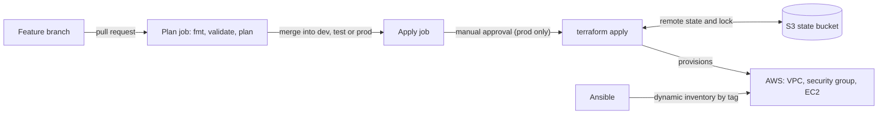

# AWS Infrastructure Automation: Terraform, GitHub Actions, and Ansible

Infrastructure for three environments (dev, test, prod) defined in Terraform and deployed by a GitHub Actions pipeline. Terraform state lives in a versioned, encrypted S3 bucket with native state locking. Ansible configures the servers afterward.

> The AWS resources have been torn down to avoid cost. The code, pipeline history, and screenshots below show the working project.

## Architecture



## What it demonstrates

- **Remote state with locking:** S3 backend with versioning, encryption, blocked public access, and native locking (`use_lockfile`). Each environment has its own state file, so runs for different environments never block each other.
- **Environment promotion:** one codebase, three branches (`dev`, `test`, `prod`). A pull request into a branch runs a plan. A merge applies it, using that environment's variable file and state.
- **Approval gate:** the `prod` GitHub environment requires a reviewer before the apply job runs.
- **Least-privilege pipeline access:** a dedicated IAM user with EC2 access and permissions scoped to the state bucket only.
- **Configuration management:** Ansible finds servers through a dynamic AWS inventory (filtered and grouped by tag) and installs nginx. Re-running the playbook changes nothing.

## Environments

| Environment | VPC CIDR | Instances |
|---|---|---|
| dev | 10.0.0.0/16 | 1 master + 1 worker |
| test | 10.1.0.0/16 | 1 master + 2 workers |
| prod | 10.2.0.0/16 | 1 master + 5 workers (approval required) |

## Repository layout

```
.
├── .github/workflows/terraform.yml   # CI/CD pipeline
├── terraform/
│   ├── backend.tf                    # S3 backend and locking
│   ├── provider.tf
│   ├── variables.tf
│   ├── vpc.tf                        # VPC, subnet, internet gateway, routes
│   ├── security.tf                   # security group
│   ├── ec2.tf                        # master instance (Ubuntu 24.04)
│   ├── worker.tf                     # worker instances (count per environment)
│   ├── outputs.tf
│   └── env/                          # dev, test, prod variable files
└── ansible/
    ├── ansible.cfg
    ├── inventory.aws_ec2.yml         # dynamic inventory
    └── playbook.yml
```

## How the pipeline works

1. Open a pull request into `dev`, `test`, or `prod`. The workflow runs `terraform fmt -check`, `validate`, and `plan` for that environment, so the exact changes are visible before anything deploys.
2. Merge the pull request. The workflow plans again and then applies.
3. The branch name selects the variable file (`env/<branch>.tfvars`) and the state key (`<branch>/terraform.tfstate`).
4. A concurrency group allows one run per environment at a time.

Changes move through the branches in order: feature branch to `dev`, then `dev` to `test`, then `test` to `prod`.

## Screenshots


## Issues solved along the way

- **Stuck state lock:** an interrupted run left a lock file in S3 that blocked later runs. Read the lock details, confirmed no run was active, and released it with `terraform force-unlock`.
- **Plan hanging in CI:** a misnamed variable in a `.tfvars` file left a required variable unset, so Terraform waited for input on a runner that couldn't answer. Fixed the variable name and flagged `-input=false` as a hardening step.
- **vCPU quota:** replacing instances failed with `VcpuLimitExceeded` because the account limit was 16 vCPUs. Freed capacity by destroying the test environment and re-ran the apply.

## Possible improvements

- Authenticate the pipeline with GitHub OIDC instead of stored access keys.
- Add `-input=false`, `-lock-timeout`, and job timeouts to the workflow.
- Use separate AWS accounts per environment and restrict SSH to a known address.
- Move the VPC and EC2 code into reusable modules.

## Running it yourself

1. Install Terraform 1.10 or newer and configure AWS credentials.
2. Create an S3 bucket (versioning on) and update the name in `terraform/backend.tf`.
3. For dev, create an EC2 key pair and set `key_name` in `env/dev.tfvars`.
4. Locally: `terraform init -backend-config="key=dev/terraform.tfstate"`, then `terraform plan -var-file=env/dev.tfvars`.
5. For the pipeline, add `AWS_ACCESS_KEY_ID` and `AWS_SECRET_ACCESS_KEY` as repository secrets and create `dev`, `test`, and `prod` environments.
6. Run `ansible-playbook playbook.yml` from the `ansible` folder against dev (needs the `amazon.aws` collection and `boto3`).